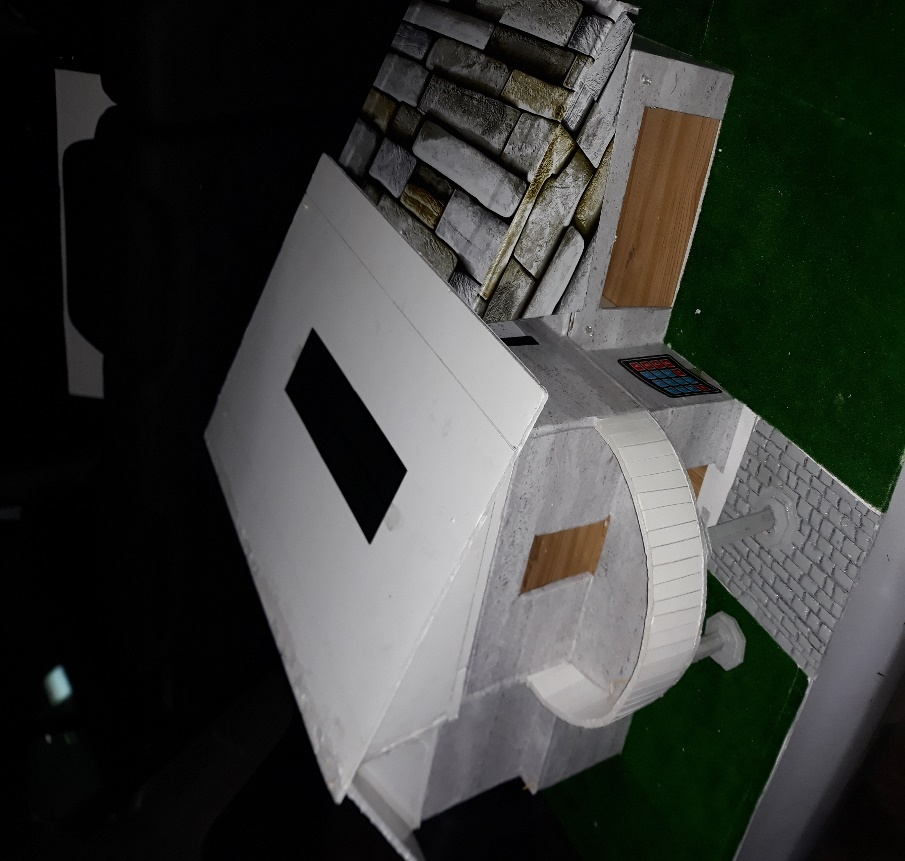
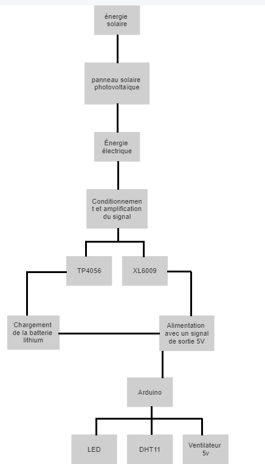
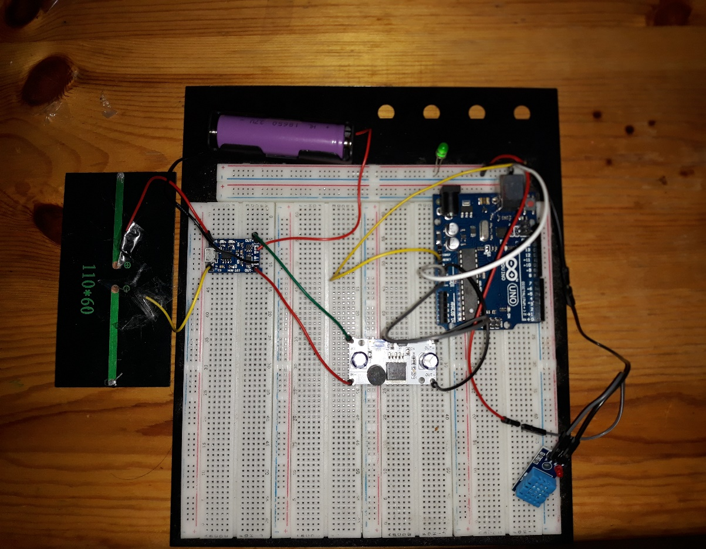
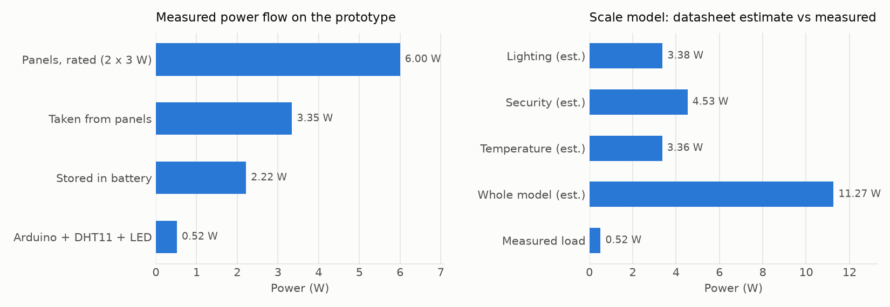

# Smart House: solar power supply for an Arduino-based home model

[](https://github.com/amine-belkacem/smart-house-solar-energy/actions/workflows/tests.yml)

I designed and built the energy part of a smart house scale model: two small solar panels charge an 18650 Li-ion cell through a TP4056, and an XL6009 boost converter feeds the Arduino Uno. This repo holds the sizing calculations (redone in Python and tested), my measurements on the prototype, and the original thesis.



## Project context

This was my licence (bachelor) thesis in electronics at USTHB, Algiers, in 2022-2023. The smart house was a larger student project with several parts: lighting, security, temperature control and energy. I took part in the whole project, but **the energy management part is the one I did on my own**: sizing the PV system for a real house, choosing the parts for the scale model, wiring and soldering the power chain, and testing it.

The Python code was not part of the thesis. I added it afterwards so every number in the report could be recomputed and checked automatically.

## Why a solar supply, and why these parts?

Algeria gets a lot of sun but solar is still rare in homes, so the idea was to show on a small scale how a house could run on its own PV system. For the model I needed something cheap and easy to source:

- **TP4056** to charge the Li-ion cell safely. It wants about 4.5 to 6 V at its input (8 V absolute max), which is why the two 6 V panels are wired **in parallel**, not in series: in series they would give 12 V and destroy the charger.
- **XL6009 boost** because one Li-ion cell (3.7 V nominal) is too low for the Uno's Vin pin, which needs 7 to 12 V. I set it to about 9 V.
- **Panel current rule of thumb**: about 1/10 of the battery capacity per hour. With a 5000 mAh cell on the label, that is 500 mA, which matches one 6 V / 500 mA panel.

## Architecture



| Block | Part | Role |
|---|---|---|
| Source | 2 x solar panel 6 V / 500 mA, in parallel | about 6 W peak (rated) |
| Charger | TP4056 module | constant current / constant voltage Li-ion charge, stops at 4.2 V |
| Storage | 18650 Li-ion, 3.7 V, "5000 mAh" on the label | keeps the board running with no sun |
| Converter | XL6009 DC-DC boost | 3.7 V to about 9 V for the Uno Vin pin |
| Load | Arduino Uno + DHT11 + LED | the part of the model powered during my tests |



## Results

### Sizing for a real house (thesis, chapter II)

With an average of 5 sun hours per day in Algiers and a correction factor K = 0.65, the peak power is Pc = E / (K x 5).

| Loads | Daily energy | Peak power needed |
|---|---|---|
| DC lighting (19 lamps of 25 W) | 1700 Wh/day | 523.08 Wc |
| AC appliances (fridge, computer, TV...) | 7581 Wh/day | 2332.62 Wc |
| Total | 9281 Wh/day | |

The fridge alone is 5700 Wh/day out of 9281, so it drives the whole sizing.

### Measured on the prototype

All values below were measured with a multimeter on the prototype. The derived lines are computed by `src/sizing.py`.

| Measurement | Value | Conditions |
|---|---|---|
| Panel open-circuit voltage | 6.85 V | full sun, 14:02 |
| Panel voltage while charging | 5.72 V | TP4056 input, battery at 3.79 V |
| Charge current | 585 mA | ammeter between TP4056 and the cell |
| Battery voltage | 4.18 V full / 3.45 V at end of test | at rest |
| Boost output | 9.05 V no load / 8.92 V loaded | |
| Load current (Arduino + DHT11 + LED) | 58 mA | between boost and Vin |
| Runtime on battery | 11 h 50 min | 4.20 V down to 3.45 V, no sun |
| Recharge time | 3 h 40 min | full sun, 11:00 to 14:40 |
| *Power taken from the panels* | *3.35 W* | *5.72 V x 585 mA* |
| *Power stored in the cell* | *2.22 W* | *charger efficiency about 66 %* |
| *Power used by the load* | *0.52 W* | *8.92 V x 58 mA* |
| *Capacity actually delivered* | *about 1950 mAh* | *assumes 85 % boost efficiency* |



Two things surprised me when I put the numbers side by side:

- **The battery is not a 5000 mAh cell.** The runtime only makes sense with about 2000 mAh. I stopped the test at 3.45 V while a Li-ion cell can go down to about 3.0 V, so the real value is a bit higher, but nowhere near the label. Cheap 18650s are often overrated like this.
- **The datasheet estimate for the full model (about 11.3 W) is far above what I measured (0.52 W).** The estimate adds up every sensor, servo, fan and ESP32 of all subsystems running at their max current at the same time, while during my tests only the Arduino, the DHT11 and a LED were connected. With the measured capacity, the whole model at 11.3 W would only run about half an hour on battery.

### Mistakes I found in my own report

Redoing the calculations in code showed a few errors in the printed thesis. The code uses the corrected values:

- DC peak power: 1700 / 3.25 = **523.08 Wc**, the report says 532.076 Wc.
- Table II.2: the 9 lamp types add up to **225 W**, not 235 W.
- Table II.5: two buzzers at 0.15 W are **0.30 W**, so the security part is 4.53 W instead of 4.38 W.
- The report describes the boost converter as "6 V to 5 V" in one place and "3.7 V to 5 V" in another. It actually takes 3.7 V from the cell up to 9 V for Vin.

## Repository structure

```
smart-house-solar-energy/
├── .github/workflows/tests.yml   # runs the tests on every push
├── data/
│   ├── loads_full_scale.csv      # thesis tables II.1 to II.3
│   ├── loads_scale_model.csv     # thesis tables II.4 to II.6
│   └── measurements.csv          # multimeter readings on the prototype
├── src/
│   ├── sizing.py                 # all sizing and energy-balance calculations
│   └── plot_energy.py            # draws docs/energy_budget.png
├── tests/
│   └── test_sizing.py            # expected values checked by hand
├── docs/                         # photos, diagram, chart, thesis PDF (French)
├── requirements.txt
└── LICENSE
```

## How to run

```bash
git clone https://github.com/amine-belkacem/smart-house-solar-energy.git
cd smart-house-solar-energy
pip install -r requirements.txt
python src/sizing.py        # prints every result in the tables above
python src/plot_energy.py   # regenerates docs/energy_budget.png
pytest -v                   # checks the results against hand calculations
```

## Limitations and possible improvements

- **Feeding Vin at 9 V wastes energy.** The Uno's linear regulator drops 8.92 V to 5 V, so about 44 % of the load power turns into heat. Setting the boost to 5 V and feeding the 5 V pin would almost double the runtime.
- **No deep-discharge protection in the design.** The TP4056 only handles charging. Unless the module includes a DW01 protection chip, nothing stops the boost from draining the cell below 3 V.
- **No MPPT.** The TP4056 pulls the panel down to whatever voltage it needs, so I only got 3.35 W out of 6 W rated. A small MPPT charger would get more out of the panels.
- **Only part of the model was powered.** The 6 W of panels could never supply the full 11 W model continuously. Powering the whole house would need bigger panels and a bigger battery.
- **Few measurements.** The values are manual multimeter readings. Logging voltage and current over a full day (for example with an INA219 on the Arduino) would give a real charge/discharge curve.
- The full-house sizing uses simple sunshine hours, not irradiation data per month, and does not size the battery bank or the inverter.

## Author

**Mohamed Amine Belkacem**  
Engineering student, M2 Electronic and Communicating Systems, Université de Lorraine  
[GitHub](https://github.com/amine-belkacem) · [LinkedIn](https://www.linkedin.com/in/mohamed-amine-belkacem-262582391)

Licence thesis, USTHB (Algiers), 2023.
